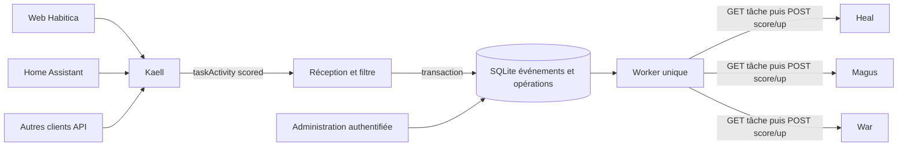
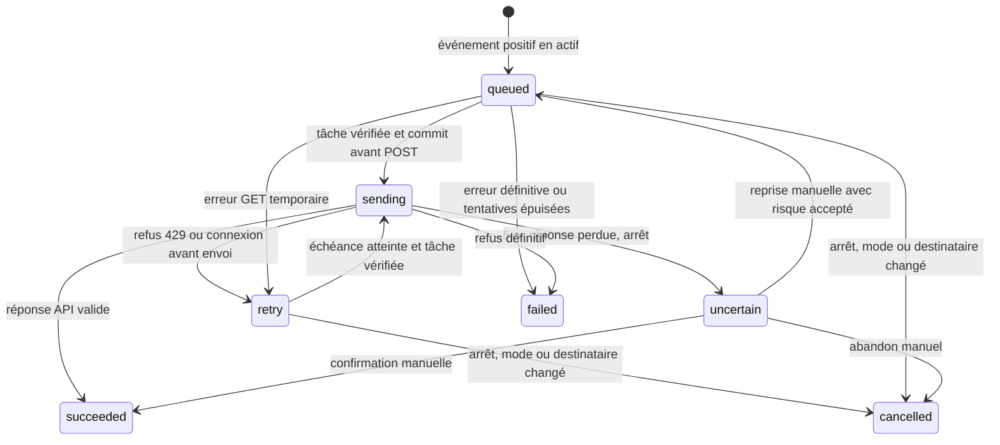

# Architecture et évolution

## Choix

Python 3.12 et FastAPI pour une API légère et une interface statique. httpx pour
le client Habitica, sans SDK supplémentaire. SQLite WAL, transactions courtes,
`synchronous=FULL`, clés étrangères et contraintes uniques pour une instance
unique sur disque local. Un thread de distribution persistant via SQLite évite
Redis, Celery et un second service permanent. pytest et un simulateur vérifient
le contrat API, les erreurs et les redémarrages.

## Modules

| Fichier | Responsabilité |
|---|---|
| `config.py` | TOML non secret, validation, références aux fichiers de clés |
| `habitica.py` | Authentification REST, contrôle des tâches, classification des erreurs |
| `rewards.py`, `companions.py` | Catalogue type/difficulté et audit/préparation des douze destinations |
| `rules.py` | Adaptation du webhook, empreinte, éligibilité positive |
| `store.py` | Schéma SQLite, transactions, verrou de processus |
| `service.py` | Ingestion atomique, fanout, audit/préparation, file et commandes de contrôle |
| `app.py`, `static/` | Réception, API de gestion authentifiée, interface française |
| `cli.py` | Installation idempotente du webhook, sauvegarde SQLite cohérente |
| `simulator.py` | Serveur/API Habitica synthétique pour essais locaux, jamais en production |

## Persistance

- `settings` : mode, date d’activation, empreintes de configuration des destinataires.
- `companions` : activation, habitude choisie, préparation et dernier audit.
- `events` : empreinte, dates source/réception, mode, raison et snapshot minimal,
  compteur de réceptions. Conservation durable des empreintes sans expiration.
- `reward_habits` : correspondances compagnon, compte et couple type/difficulté vers les tâches.
- `operations` : destinataire, tâche, type et difficulté figés, état, tentatives, échéance et erreur.
  Unicité `(event_id, companion)`.
- `audit_log` : changements de mode, activation, préparation et résolutions manuelles.

La migration v1 → v2 est atomique, en observation et sans rejeu ; voir `MISE_A_JOUR_0_2.md`.
Le schéma est versionné par `PRAGMA user_version`. Une version inconnue échoue
explicitement. Les futures migrations devront être testées sur des sauvegardes.
Aucune clé API ni secret de webhook/administration en base.

Ingestion : classification → transaction événement + opérations → commit → HTTP
202. Le worker n’est pas requis pour accepter un événement. Le mode d’ingestion
reste attaché à l’événement : observation et simulation ne deviennent pas des
récompenses lors d’une activation ultérieure. Les événements source antérieurs
à l’activation sont exclus en actif, à la précision milliseconde de l’historique.
Synchroniser les horloges Ubuntu/Habitica ; tolérance future maximale : cinq minutes.

## Cycle d’une opération

Un GET échoué est repris sans score. Avant POST, `sending` est durablement
commité. Au redémarrage, tout `sending` devient `uncertain`, même si l’arrêt
a précédé le POST : priorité à l’absence de double attribution, au prix d’une
vérification manuelle. Une réponse de score perdue n’est pas prouvable par les
seuls compteurs Habitica. Les reprises automatiques sont bornées à six essais
par défaut ; chaque compagnon garde sa propre échéance.

Le worker traite une opération par intervalle de 0,5 seconde : au plus deux
POST de score par seconde, plus leurs GET de contrôle. Une erreur sur Heal
n’empêche pas Magus et War. Les contrôles et les requêtes utilisent le même
verrou pour qu’un arrêt validé ne soit pas suivi d’un nouvel envoi. Une requête
déjà en vol peut finir avant que la commande d’arrêt soit acquittée.

## Compagnons et habitudes

Liste configurable de longueur variable, sans limite à trois dans le moteur.
Ajouter/retirer un compte dans le TOML puis redémarrer ; désactivation immédiate
dans l’interface. Retirer un compagnon ne supprime jamais son compte ou ses tâches.
Les opérations historiques conservent l’ancien destinataire. Changer son ID,
son `task_id` ou l’alias technique invalide la préparation ; les opérations dont
la cible a changé ne sont pas distribuées.

L’audit GET liste les quotidiennes à risque de pénalité et les autres habitudes
pouvant avoir une automatisation externe. L’API seule ne permet pas d’identifier
une automatisation Home Assistant existante : vérification humaine nécessaire.
La préparation exige l’empreinte du rapport consulté ; une modification des tâches
oblige à relire le rapport. Les douze habitudes sont choisies par alias unique
par couple type/difficulté et compte. Aucune correspondance sur le seul titre.
L’ancien UUID configuré reste accepté en référence à l’habitude v0.1 inutilisée.

Le client contrôle avant chaque score : habitude, positive uniquement,
propriétaire attendu, tâche personnelle hors défi/groupe. Une tâche devenue
incompatible échoue sans être modifiée. Une création dont la réponse se perd
doit être retrouvée par alias au prochain audit, sans nouvelle création aveugle.

## Sécurité et exploitation

Jetons aléatoires distincts pour administration et webhook, clés en fichiers
root:groupe 10001, lecture seule dans le conteneur. UID/GID 10001, système de
fichiers en lecture seule, capacités supprimées, interdiction de nouveaux
privilèges, limites CPU/RAM/PID. Pas de socket Docker monté, de CORS ouvert,
de cookie de session ou de dépendance JS distante. CSP et échappement par
`textContent` dans l’interface. Limite de corps y compris transfert chunked.

Le webhook est une URL secrète non signée ; protéger son chemin des logs de
proxy. Les logs HPM sont des objets JSON sans payload brut ni exception HTTP.
Les traces de démarrage sont techniques et les erreurs de validation de
configuration sont expurgées. Le journal affiche des identifiants et erreurs
stables, pas les clés. TLS demeure vérifié ; une CA privée peut être montée
via `SSL_CERT_FILE` sans désactiver la vérification.

## Évolution après recette locale

1. **Stabilisation** : captures réelles, surveillance du webhook et de la file,
   tests batch/concurrence Habitica, suivi du comportement Cron et des quêtes.
   Polling de diagnostic possible, sans rattrapage automatique.
2. **Pondération future au-delà du routage type/difficulté 0.2** : extraire une politique `plan(event, companion)` retournant
   des actions typées. Conserver une provenance et un nombre maximal de scores.
   Pas de changement direct d’XP ; étudier l’effet de difficulté et de classe.
3. **Synchronisation complète** : ajouter `task_links(master_task_id, companion,
   target_task_id, strategy, version)` et des adaptateurs created/updated/deleted/
   checklist. Gestion explicite des conflits, archivage et sémantique des dates.
   Conserver l’inbox et la file ; ajouter le type d’action sans réinterpréter
   les événements historiques déjà traités.
4. **Transition A/B/hybride** : associer stratégie et version aux nouvelles
   opérations, date de bascule et inventaire initial sans distribution rétroactive.
   Un événement a une seule stratégie par compagnon pour éviter les doubles gains.
5. **Journées et RPG** : politique Cron explicitement approuvée après traitement
   des quotidiennes existantes ; fuseaux, heure de début, DST Europe/Paris,
   annulations, streaks, quêtes et compétences. Ne pas supposer qu’un streak
   historique ou un résultat de quête est modifiable fidèlement via l’API.

La version 0.2 fournit douze habitudes techniques par compagnon, mais toujours
un seul score positif par événement et compagnon, selon le type et la difficulté.
Elle ne développe pas les modes avancés, pénalités, compétences ou inventaires.
